---

## 1. Standardized Master Drill Table

| \# | Drill | Category | Position Group | Why it matters in games | GIF |
| :--- | :--- | :--- | :--- | :--- | :---: |
| 1 | 40-Yard Dash | Timing & Speed | WR, TE, OL, DL, DB | Pure straight-line speed: running away from (or chasing down) anyone in the open field. | 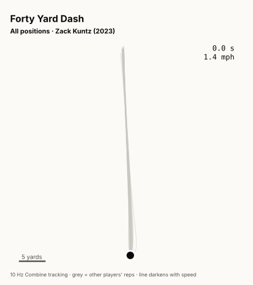 |
| 2 | Vertical Jump | Explosiveness | WR, TE, OL, DL, DB | Lower-body explosiveness: winning jump balls, and power off the snap. | — (stopwatch only, no tracking) |
| 3 | 3-Cone Drill | Agility & COD | WR, TE, OL, DL, DB | Bending around tight corners at speed: rounding routes, chasing the QB, closing on the ball. | 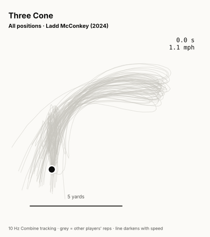 |
| 4 | 20-Yard Short Shuttle | Lateral Quickness | WR, TE, OL, DL, DB | Stop, plant and go the other way: the change of direction behind every cut and reaction. | 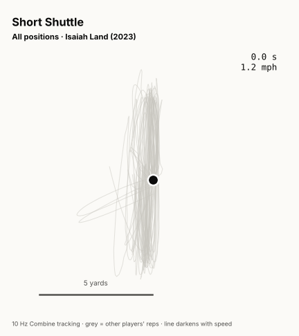 |
| 5 | OL Pull Drill: Fold Block Right | Offensive Line | OL | Short, quick pull around a teammate: sealing the hole on inside runs. | 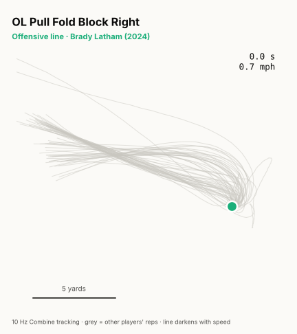 |
| 6 | OL Pull Drill: Deep Short Pull Left | Offensive Line | OL | Leaving the line at an angle and finding a target: lead blocking on gap runs. | 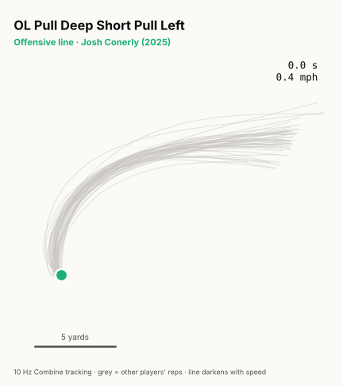 |
| 7 | OL Pull Drill: Long Pull Right | Offensive Line | OL | Running laterally in space: leading outside runs and sweeps. | 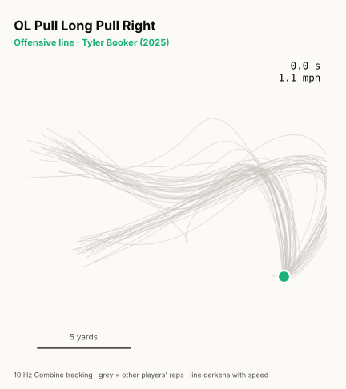 |
| 8 | Pass Protection Mirror Drill | Offensive Line | OL | Sliding to shadow a rusher without crossing feet: keeping the QB clean. | 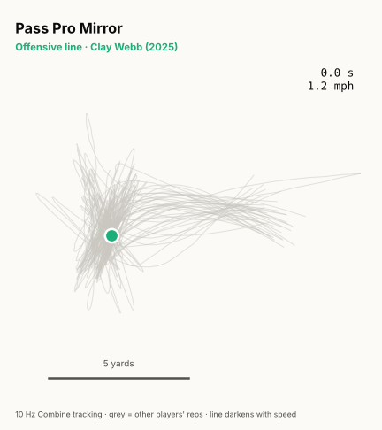 |
| 9 | Block Explosion Drill | TE Blocking | TE | Firing out of a stance with power: winning blocks on run plays. | 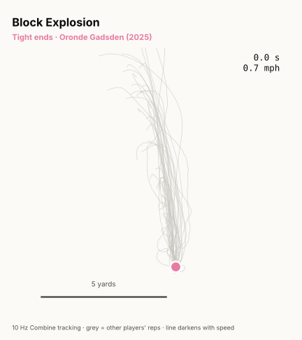 |
| 10 | Screen Drill | Offensive Line | OL | Releasing downfield and blocking in space: springing screen passes. | 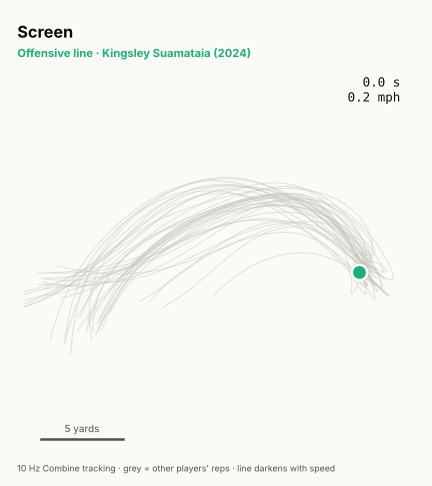 |
| 11 | Pass Rush Drop | Offensive Line / Pass Pro | OL | Quick kick-slide into a pass set: getting depth before the edge rusher arrives. | 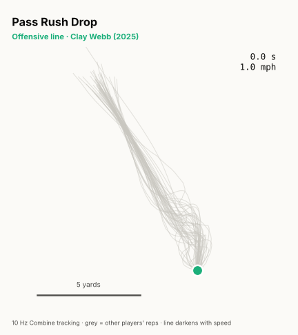 |
| 12 | Pass Rush Drill | Defensive Line / EDGE | DL | Beating a blocker with a rip or swim and finishing: pressures and sacks. | 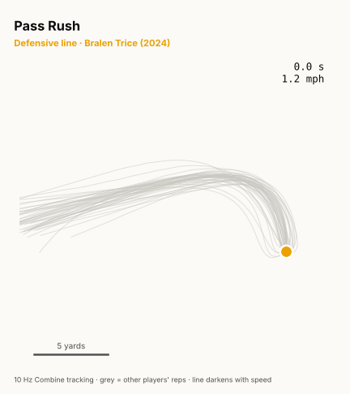 |
| 13 | Run & Club Drill | Pass Rush | DL | Winning the edge with a club move at speed: getting past tackles. | 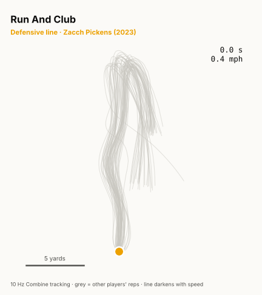 |
| 14 | Run the Hoop Drill | Pass Rush / Bend | DL | Bending around a tight circle while leaning in: turning the corner to the QB. | 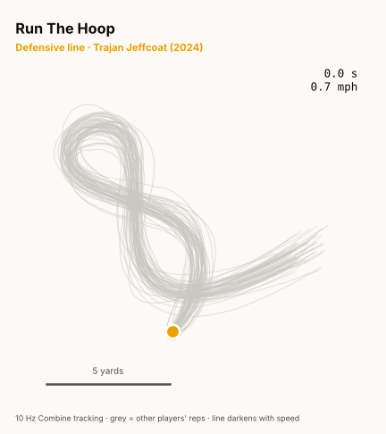 |
| 15 | Short Zone Break: Forward | Defensive Line / Coverage Drop | DL | Driving downhill out of a drop: stopping short passes underneath. | 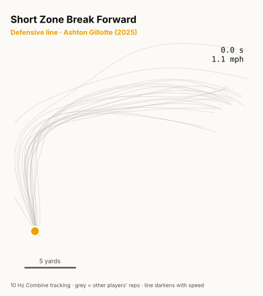 |
| 16 | Short Zone Break: Flat/Wheel | Defensive Line / Coverage Drop | DL | Turning to run with a back out of the flat: covering wheel routes. | 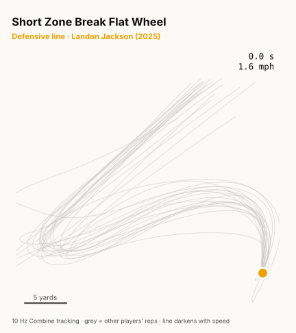 |
| 17 | Short Zone Break: Inside | Defensive Line / Coverage Drop | DL | Breaking back inside from a drop: closing on slants and crossers. | 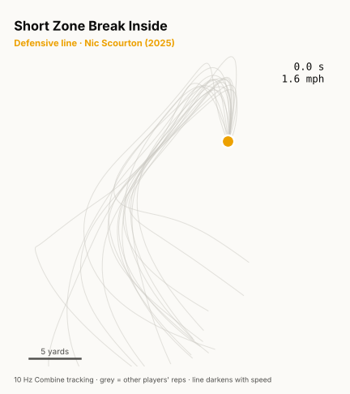 |
| 18 | Short Zone Breaks (General) | Defensive Line / Coverage Drop | DL | Dropping into a zone and breaking on the throw: edge rushers asked to cover. | 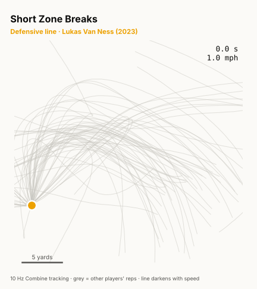 |
| 19 | 5-Yard Wave Drill (Slide & Shuffle) | Offensive Line | OL | Reacting to direction changes while staying balanced: handling stunts and counters. | 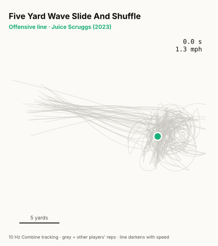 |
| 20 | Front Start Wave & Lateral Reaction | Defensive Line / Agility | DL | Reacting to a direction change from a stance: chasing runs and scrambling QBs. | 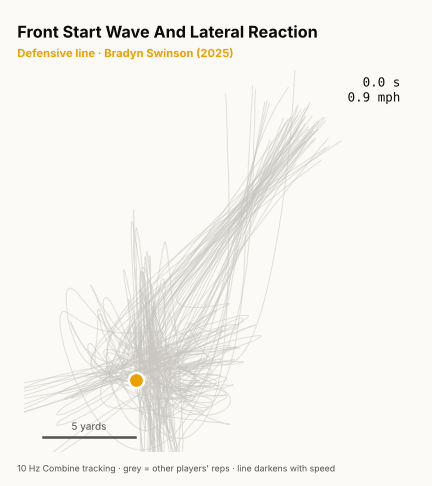 |
| 21 | Backpedal & React | Defensive Line / Coverage Drop | DL | Dropping back and breaking on the ball: edge players dropping into coverage. | 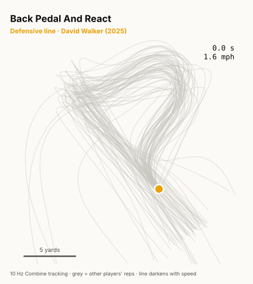 |
| 22 | Backpedal & 45° Transition | Secondary | DB | Opening the hips from a backpedal: carrying receivers who go deep. *(2024 reps are truncated)* | 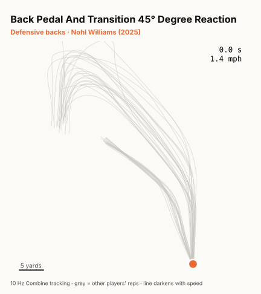 |
| 23 | Backpedal & 90° Break to Ball | Secondary | DB | Backpedal, plant, drive sideways: breaking on out routes. | 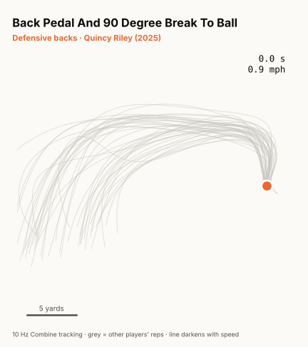 |
| 24 | Teryl Austin DB Drill #1 | Secondary | DB | Backpedal and break at an angle on cue: reading the QB and closing on the ball. | 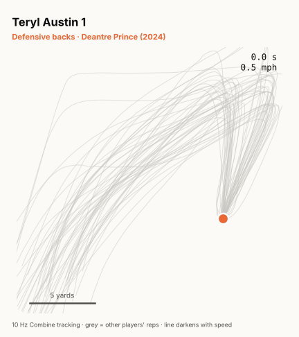 |
| 25 | Teryl Austin DB Drill #2 | Secondary | DB | Backpedal, turn and run: staying with receivers who stem vertically. | 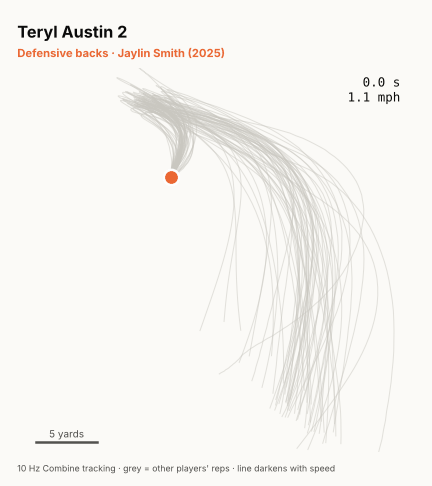 |
| 26 | Gauntlet Catching Drill | Receiver / TE / RB | WR, TE, DB | Catching at full speed with eyes on the ball: crossing routes for WR/TE, turning breakups into interceptions for DBs. | 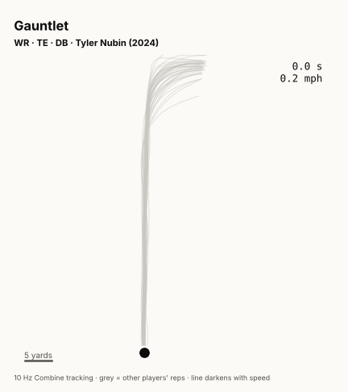 |
| 27 | Over the Shoulder Adjustment | Receiver / TE | WR, TE | Tracking a deep ball and adjusting late: the catch on long and seam throws. | 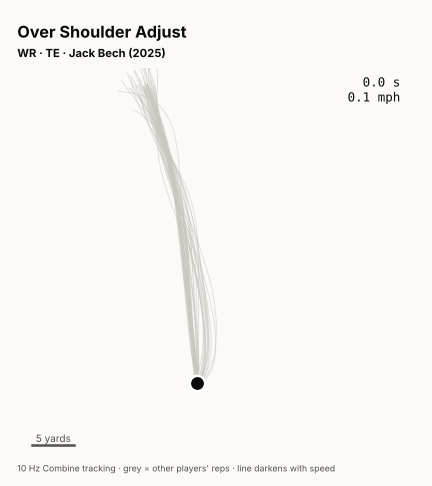 |
| 28 | Corner Route | Route Tree | TE | Breaking to the sideline at depth: stretching zones vertically. | 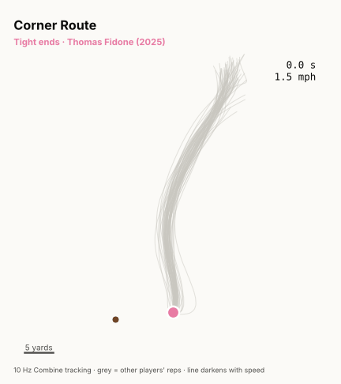 |
| 29 | Flat Route (Left) | Route Tree | TE | Releasing quickly to the flat: easy yards and play-action answers. | 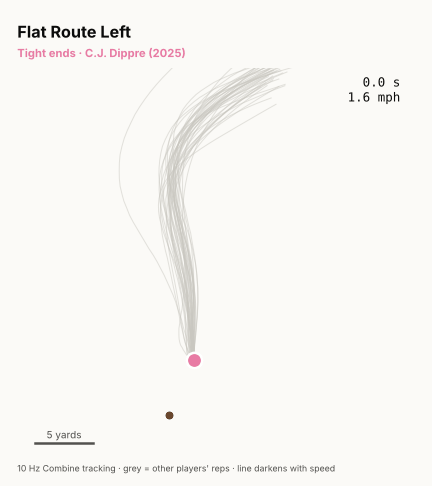 |
| 30 | Hook Route (Right) | Route Tree | TE | Settling in a zone gap and turning to the QB: moving the chains on 3rd down. | 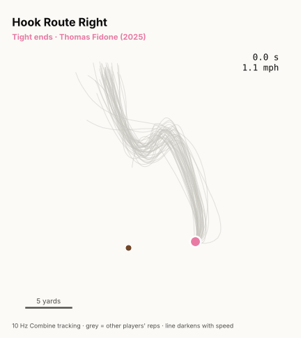 |
| 31 | End Zone Fade (Right) | Route Tree | TE | Using size near the boundary: red-zone touchdowns. | 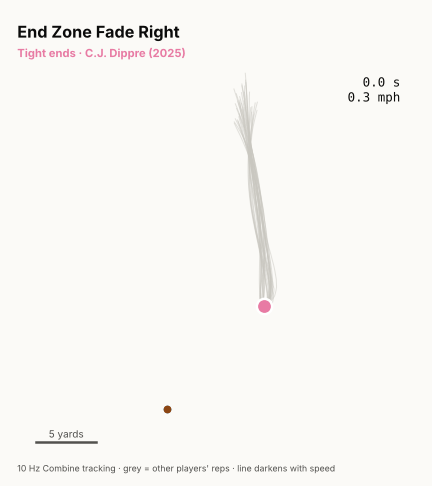 |
| 32 | Red Zone Fade (Right) | Route Tree | WR | Separating in a tight space near the sideline: scoring in the red zone. | 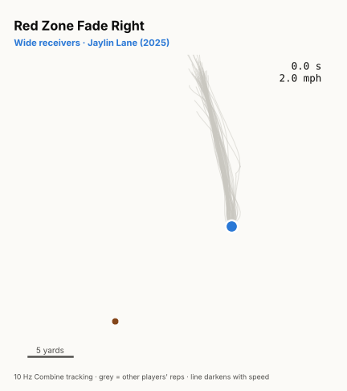 |
| 33 | In Route (Left) | Route Tree | TE | Sharp inside break in traffic: catching in front of linebackers. | 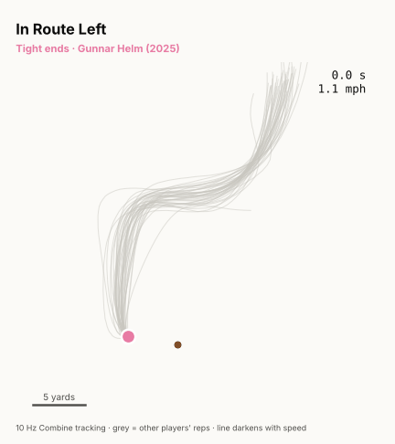 |
| 34 | Wheel Route (Left) | Route Tree | TE | Turning upfield from the flat: exploiting slower linebackers in coverage. | 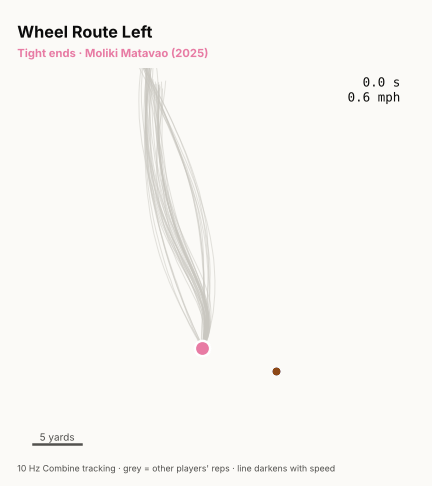 |
| 35 | Post-Corner Route (Right) | Route Tree | WR | Selling the post, then snapping to the corner: beating safeties deep. | 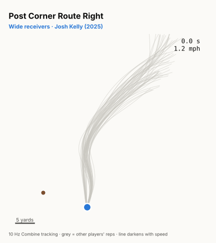 |
| 36 | Post-Corner Route (Left) | Route Tree | WR | Same double move to the other side: the route works from either alignment. | 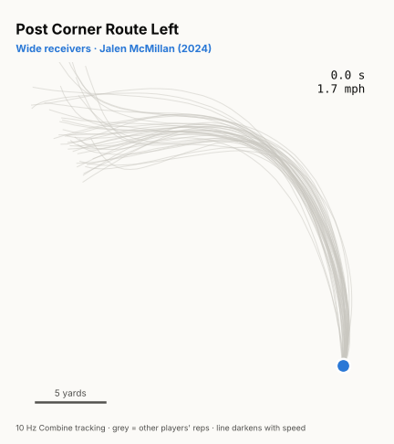 |
| 37 | Go Route (Right) | Route Tree | WR | Top-end speed downfield: forcing defenders to back off and respect the deep ball. | 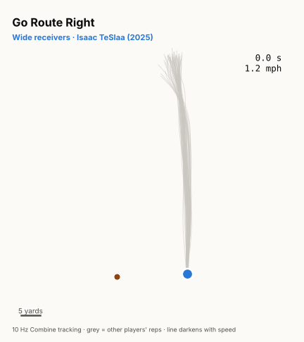 |
| 38 | Circus Route (Left) | Route Tree | WR | Body control on awkward catches: turning broken plays into completions. | 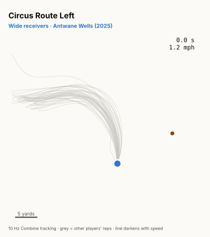 |
| 39 | Slant Route (Left) | Route Tree | WR | A fast, sharp break inside: the quick throw that beats blitzes and tight coverage. | 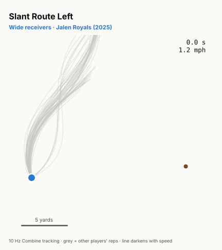 |
| 40 | Speed Out Route (Left) | Route Tree | WR | Cutting to the sideline without slowing down: separation on timing throws. | 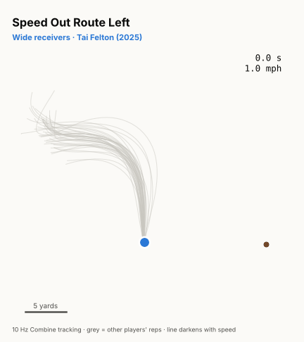 |
| 41 | Curl Route (Right) | Route Tree | WR | Selling deep, then stopping and turning back: winning against defenders who play off. | 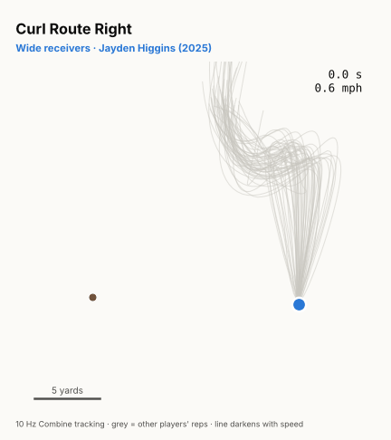 |
| 42 | Dagger Route (Left) | Route Tree | WR | Breaking inside at depth: attacking the middle behind the linebackers. | 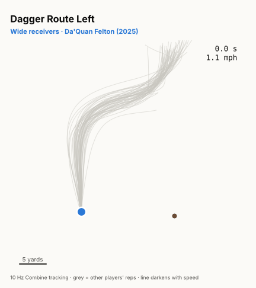 |
| 43 | Slot Strike Route (Left) | Route Tree | WR | Quick release and break from the slot: winning fast against nickel corners. | 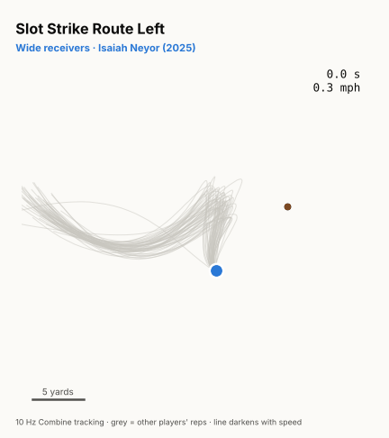 |
| 44 | Comeback Route (Right) | Route Tree | WR | Braking hard after a vertical stem: getting open when the DB is running with you. | 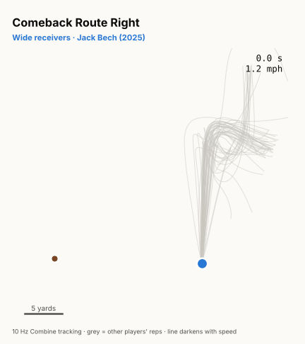 |
| 45 | Slot Sail Route (Right) | Route Tree | WR | Climbing and bending to the sideline from the slot: attacking zone holes. | 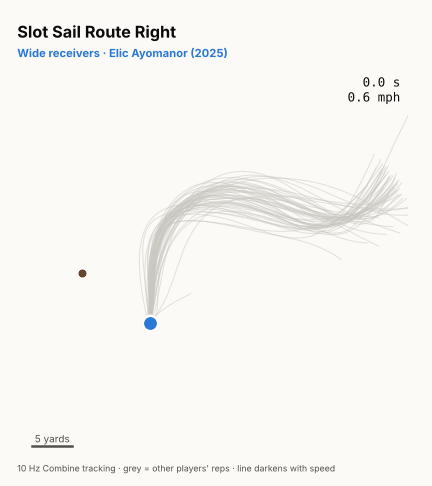 |
| 46 | Body Control Drill | Footwork & Balance | DL | Changing direction with a low centre of gravity: shedding blocks and redirecting. | 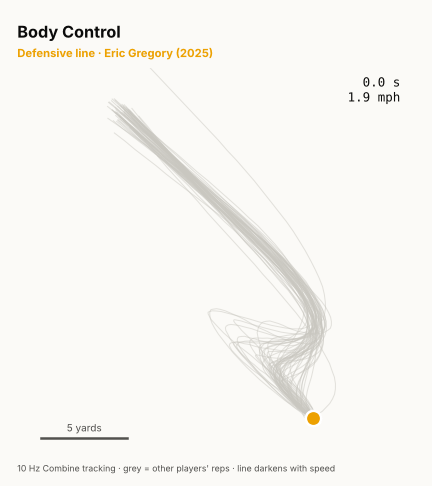 |
| 47 | Four Bag Agility Drill | Bag Agility | DL | Quick, controlled feet through traffic: stepping over bodies in the trenches. | 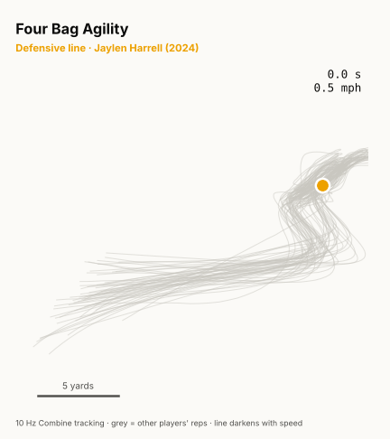 |
| 48 | Four Bag Shuffle Drill | Bag Agility | DL | Lateral shuffle while staying square: flowing to the ball on runs. | 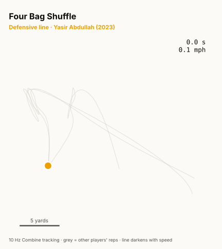 |
| 49 | Box Drill | Change of Direction | DB | Sprint, shuffle and backpedal around a square: every movement a DB uses in one rep. | 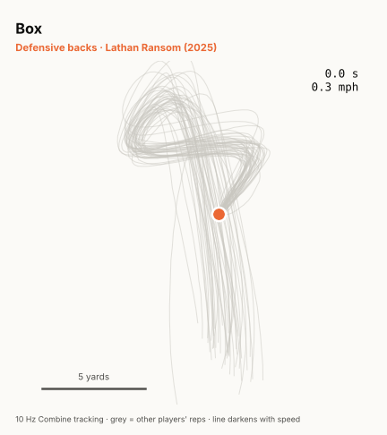 |
| 50 | W-Drill | Backpedal & Plant | DB | Repeated backpedal-and-drive zig-zags: keeping the pedal smooth while reacting to the route. | 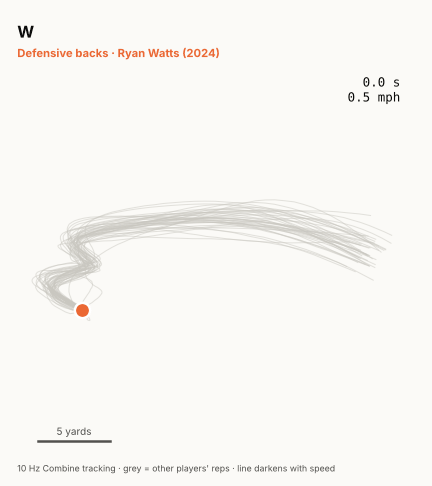 |
| 51 | Line Drill | Speed & Conditioning | DB | Straight backpedal-to-sprint transitions: speed turning to run with a receiver. | 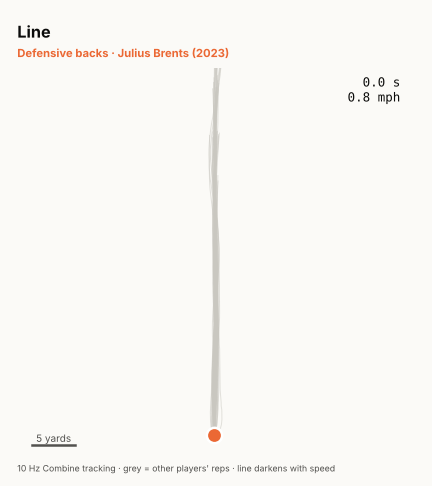 |
| 52 | Shuffle, Sprint & COD Drill | Agility & Acceleration | DL | Shuffle then burst: pursuing plays that bounce outside. |  |
| 53 | Wave Drill | Reactive Agility | DL | Reactive changes of direction: tracking the ball carrier. |  |
